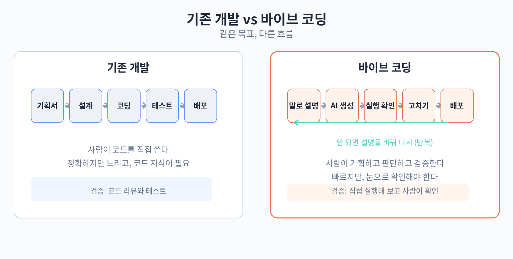

# 11. 기존 개발과의 차이

## 두 가지 개발 흐름

소프트웨어가 만들어지는 과정은 크게 다섯 단계로 나눌 수 있다. 기획서 쓰기, 설계, 코딩, 테스트, 배포이다. 기존 개발과 바이브 코딩은 이
다섯 단계를 모두 거치지만, 각 단계에서 사람과 AI의 역할 분담이 완전히 다르다.

기존 개발의 흐름은 이렇다. 먼저 기획서를 쓴다. 무슨 기능을 넣을지 문서로 정리한다. 다음으로 설계한다. 화면 구성, 데이터 구조, 프로그램
흐름을 정한다. 그 다음 코딩한다. 설계에 따라 프로그래밍 언어로 코드를 직접 타이핑한다. 그 다음 테스트한다. 오류를 찾아 고친다. 마지막으로
배포한다. 사용자가 쓸 수 있도록 서버에 올린다. 각 단계마다 전문 지식이 필요했고, 전체를 혼자 해내기 어려웠다.

바이브 코딩의 흐름은 이렇다. 먼저 말로 설명한다. "무엇을 만들고 싶은지"를 글로 적는다. 다음으로 AI가 생성한다. 설명을 듣고 코드를
자동으로 만들어 낸다. 그 다음 실행해 본다. 만들어진 것을 직접 열어 보며 동작을 확인한다. 마음에 들지 않으면 "이렇게 고쳐 줘"라고 다시
말로 지시하고, 다시 생성하고 실행해 본다. 괜찮아지면 배포한다. 마지막 단계는 기존 개발과 같다.

차이를 한 줄로 말하면, 기존 개발은 '문서에서 코드로' 가는 길이고, 바이브 코딩은 '말에서 코드로' 가는 길이다. 기획서와 설계가 사라지는
것이 아니라, 형식이 바뀐 것이다. 문서 대신 대화가 기획이 되고, 설계도 대신 AI와의 주고받음이 설계가 된다.

## 단계별 사람과 AI의 역할 대조

각 단계에서 누가 무엇을 하는지 비교해 보자.

### 1단계: 기획

기존 개발에서는 기획자나 개발자가 문서로 요구사항을 정리한다. 화면별 기능 목록, 사용자 시나리오, 예외 상황까지 적는다. 보통 며칠에서 몇
주가 걸린다.

바이브 코딩에서는 사람이 AI에게 말로 요구사항을 설명한다. "고객이 이름을 입력하고, 날짜를 고르고, 예약 확인 화면이 나와야 해"처럼
설명한다. 문서를 다듬는 대신, 대화를 나누면서 요구사항이 정리된다. 소요 시간은 수십 분이다.

### 2단계: 설계

기존 개발에서는 화면 설계서, 데이터베이스 구조, API 명세 같은 설계 문서를 만든다. 이 단계부터 프로그래밍 지식이 필요했다.

바이브 코딩에서는 AI가 설계도 함께 맡는다. 사람의 설명을 듣고 화면 구성과 데이터 구조를 알아서 정한다. 사람이 할 일은 AI가 정한 방식을
확인하고, 마음에 들지 않으면 "데이터는 저장하지 말고 그냥 화면에만 보여 줘"처럼 방향을 고치는 것이다.

### 3단계: 코딩

기존 개발에서는 개발자가 코드를 직접 작성한다. 프로그램의 규모에 따라 며칠에서 몇 달이 걸리는 단계이다. 코드 문법을 모르면 이 단계에서
멈춘다.

바이브 코딩에서는 AI가 코드를 생성한다. 사람의 설명을 받아 몇 초에서 몇 분 만에 결과물을 내놓는다. 사람은 타이핑하지 않는다. 이 단계에서
비개발자가 멈추지 않게 되는 것이 바이브 코딩의 가장 큰 차이이다.

### 4단계: 테스트

기존 개발에서는 개발자가 테스트 코드를 작성하거나, 오류를 재현해 가며 디버깅한다. 오류 메시지를 읽고 원인을 추적하는 전문 기술이 필요했다.

바이브 코딩에서는 사람이 실제로 사용해 보며 확인한다. 버튼을 눌러 보고, 이상한 값을 입력해 보고, 휴대폰에서도 열어 본다. 문제가 생기면
오류 메시지를 AI에게 그대로 보여 주며 "이 오류가 나는데 고쳐 줘"라고 말한다. 오류를 읽을 줄 몰라도 된다.

### 5단계: 배포

기존 개발과 바이브 코딩 모두, 만든 것을 인터넷에 올려 사용자가 쓸 수 있게 하는 단계이다. 서버 설정, 도메인 연결 같은 작업이 필요한데,
요즘은 이 과정을 도와주는 서비스가 많아 바이브 코딩에서도 큰 장벽이 되지 않는다.

아래 표는 두 방식을 한눈에 비교한 것이다.

| 단계 | 기존 개발 | 바이브 코딩 |
|---|---|---|
| 기획 | 문서로 요구사항 정리 (며칠~몇 주) | AI에게 말로 설명 (수십 분) |
| 설계 | 설계 문서 작성 (전문 지식 필요) | AI가 자동 설계, 사람은 방향만 수정 |
| 코딩 | 직접 타이핑 (며칠~몇 달) | AI가 생성 (몇 초~몇 분) |
| 테스트 | 오류 추적과 디버깅 (전문 기술) | 직접 사용해 보고 AI에게 수정 요청 |
| 배포 | 서버 설정 후 배포 | 같은 배포, 보조 서비스로 간소화 |

## 비유: 주방장에게 말로 주문하기

바이브 코딩을 한 비유로 설명하면 "요리 레시피를 직접 쓰지 않고, 주방장에게 말로 주문하기"이다.

기존 개발은 요리사가 되는 것과 같다. 재료를 고르고, 칼질을 하고, 불 조절을 한다. 모든 과정을 직접 해야 맛있는 음식이 나온다. 배우는 데
시간이 걸리지만, 원하는 맛을 정확히 낼 수 있다.

바이브 코딩은 레스토랑에 가는 것과 같다. "매콤한 해물 요리를 원해요. 밥이랑 같이 주세요"라고 주문한다. 주방장이 알아서 만들어 낸다.
본인은 요리법을 몰라도 된다. 대신 맛을 보고 "좀 더 맵게 해 주세요", "간이 세요"처럼 피드백을 줘야 원하는 맛에 가까워진다. 피드백이
구체적일수록 결과가 좋아진다.

이 비유에서 중요한 점이 하나 있다. 손님이 맛을 볼 줄 알아야 한다는 것이다. 요리법을 몰라도, 음식이 맛있는지 없는지는 알아야 한다. 바이브
코딩도 마찬가지이다. 코드를 읽을 줄 몰라도, 만들어진 것이 자기 의도에 맞는지 판단할 줄 알아야 한다. 10장에서 말한 '판단'의 역할이 바로
이것이다.

또 다른 비유도 있다. 건축주가 집을 짓는 과정이다. 기존 개발은 직접 벽돌을 쌓는 것과 같고, 바이브 코딩은 시공사에게 "햇볕 잘 들고 아이들
놀 공간이 있는 집을 지어 줘"라고 주문하는 것과 같다. 건축주가 벽돌을 쌓을 줄 몰라도 집을 지을 수 있다. 다만 어떤 집을 원하는지, 완성된
집이 마음에 드는지 말할 수 있어야 한다.

## 속도와 정확도의 트레이드오프

바이브 코딩의 가장 큰 장점은 속도이다. 기존 개발에서 한 달이 걸릴 일을 며칠 만에 만들어 볼 수 있다. 아이디어를 빠르게 시험해 보는 데에는
이보다 좋은 방법이 없다. "일단 만들어 보고 반응을 보자"가 실제로 가능해진다.

하지만 속도에는 대가가 따른다. 정확도이다. AI는 사람이 원하는 것과 비슷해 보이는 결과를 내지만, 세부 사항에서 틀릴 수 있다. 예를 들어
날짜 계산이 하루씩 어긋나거나, 금액 합계가 소수점 둘째 자리에서 어긋날 수 있다. 코드를 읽을 줄 모르면 이런 오류를 눈으로 발견하기 어렵다.

정확도의 차이는 영역에 따라 심각도가 다르다. 랜딩 페이지의 문구가 어색하면 고치면 된다. 하지만 금액 계산이 틀리면 손님이 잘못된 금액을 보게
된다. 이 트레이드오프를 어떻게 관리할지는 12장(실패 패턴)과 13장(기대치 정하기)에서 자세히 다룬다.

솔직히 말하면, 바이브 코딩은 기존 개발을 완전히 대체하지 않는다. 기존 개발이 정확히 설계된 도면으로 집을 짓는 것이라면, 바이브 코딩은
스케치로 빠르게 모형을 만드는 것이다. 모형으로 집의 형태를 확인할 수는 있지만, 실제로 사람이 살 집을 지으려면 도면과 감리가 필요하다. 둘은
경쟁 관계가 아니라 용도가 다른 도구이다.

## 바이브 코딩이 특히 잘 맞는 사람

정리하면, 바이브 코딩은 이런 사람에게 잘 맞는다. 아이디어는 있지만 개발자가 아닌 사람, 아이디어를 빠르게 검증하고 싶은 1인 사업자, 반복
업무를 줄이고 싶은 실무자이다. 반대로, 처음부터 많은 사람이 쓰는 서비스를 만들려는 경우나, 정확도가 생명인 분야에서는 주의가 필요하다.
어디까지 맡기고 어디서 멈춰야 할지 아는 것이 이 책의 뒷부분에서 다룰 핵심 주제이다.

## 같은 일을 만들 때 걸리는 시간 비교

간단한 예약 안내 페이지를 만든다고 가정해 보자. 기존 개발에서는 기획서
작성 2일, 화면 설계 2일, 코딩 3일, 테스트 1일, 배포 1일로 약 9일이
걸린다. 개발자 한 명이 전담한다는 전제이다. 비개발자라면 코딩 단계에서
아예 멈춘다.

바이브 코딩에서는 설명 30분, AI 생성 5분, 실행해 보고 고치기 2시간, 배포
30분으로 반나절이면 된다. 물론 결과물의 완성도는 다르다. 기존 개발의
결과물은 예외 상황까지 처리된 튼튼한 것이고, 바이브 코딩의 결과물은
기본 기능이 동작하는 수준이다. 하지만 "예약 안내를 보여 주는 것"이라는
목적만 놓고 보면, 반나절짜리 결과물로도 충분한 경우가 많다.

여기서 중요한 것은 "완성도"의 기준이 목적에 따라 달라진다는 점이다.
내부에서 쓸 도구라면 기본 동작만으로 충분하다. 수만 명이 쓸 서비스라면
예외 처리까지 된 튼튼함이 필요하다. 목적에 맞는 완성도를 선택하는 것이지,
무조건 튼튼하게 만드는 것이 정답은 아니다.

## 개발자는 바이브 코딩을 어떻게 볼까

개발자 커뮤니티에서 바이브 코딩에 대한 평가는 엇갈린다. "코드를 모르는
사람이 만든 것은 진짜 소프트웨어가 아니다"라는 비판이 있는 반면, "단순한
일은 AI에게 맡기고 어려운 일에 집중할 수 있게 됐다"는 환영도 있다.

실제로 많은 개발자가 바이브 코딩 방식을 업무에 섞어 쓰고 있다. 반복적인
화면 작업은 AI에게 맡기고, 복잡한 로직과 설계는 직접 하는 식이다. 개발자도
AI를 쓰는 시대이다. 차이는 개발자는 AI가 만든 코드를 읽고 검증할 수
있다는 점이다.

비개발자에게 시사하는 바가 있다. 바이브 코딩으로 만든 것을 개발자에게
보여 줄 때, "이렇게 만들었는데 이상한 부분 좀 봐주세요"라고 하면 대부분
흔쾌히 봐준다. 동작하는 것을 들고 가는 것과 아이디어만 들고 가는 것은
다르다. 바이브 코딩은 전문가와 협업할 때의 출발점이 되기도 한다.

## 정리

기존 개발은 기획서-설계-코딩-테스트-배포의 순서로 사람이 직접 코드를 쓰지만, 바이브 코딩은 말로 설명- AI가 생성-실행해 보고 고치기의
순서로 AI가 코드를 만든다. 각 단계마다 사람과 AI의 역할이 바뀌고, 특히 코딩 단계의 장벽이 사라진다. 대신 속도와 정확도 사이의
트레이드오프가 생기고, 사람은 맛을 보는 손님처럼 결과를 판단하는 역할을 맡는다. 한 가지 덧붙이자면, 두 방식은 섞어 쓸 수도 있다. 바이브 코딩으로 빠르게
시작하고, 잘 되는 부분은 기존 개발 방식으로 다듬는 것이다. 실제로 많은
현업 개발자가 이 혼합 방식을 쓰고 있다. 다음 장에서는 이 방식의 솔직한 한계와 실패 패턴을 살펴본다.
