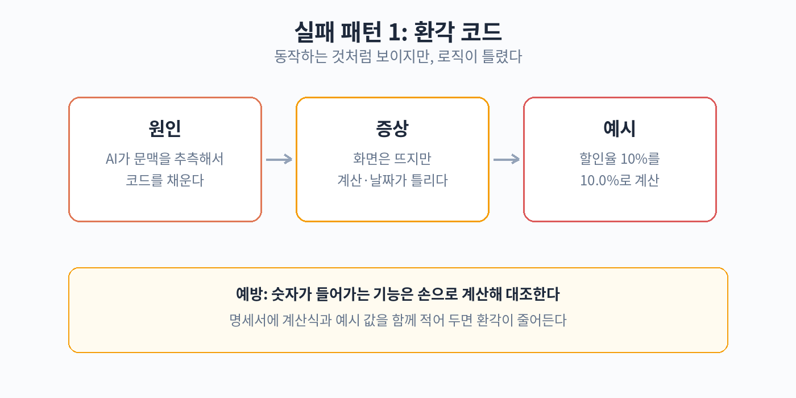
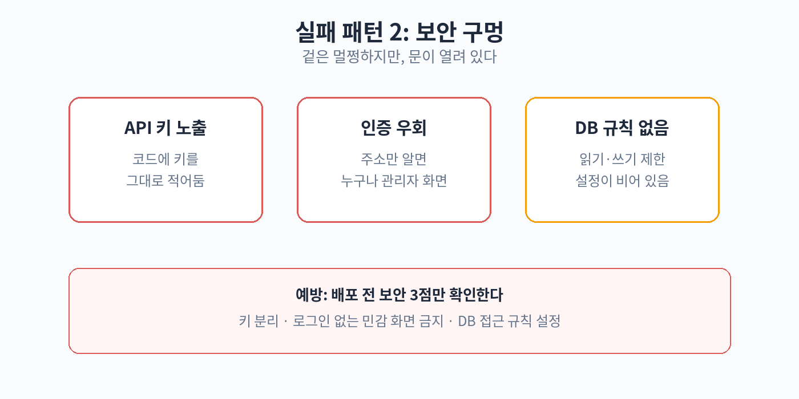
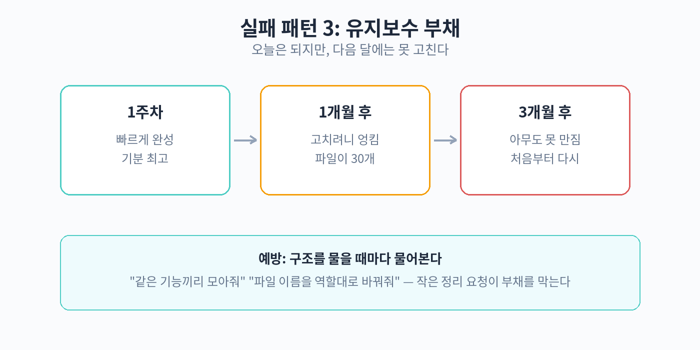

# 12. 솔직한 한계와 실패 패턴

이 장은 이 책에서 가장 솔직한 장이다. 바이브 코딩으로 만들다 보면 반드시 마주치는 세 가지 실패 패턴을 다룬다. AI가 겉보기에는 그럴듯한
코드를 내주지만, 실제로는 틀린 로직이 숨어 있는 경우, 보안에 구멍이 난 경우, 동작은 하지만 구조가 엉망이라 나중에 손대기 어려워지는
경우이다. 각각이 왜 생기고, 왜 발견하기 어렵고, 어떻게 예방하는지 차례대로 살펴본다.

## 실패 패턴 1: 환각 코드

환각(Hallucination)은 AI가 실제로는 틀린 정보를 자신감 있게 내놓는 현상이다. 코드 생성에서도 똑같이 일어난다. 실행은 되는데,
로직이 틀린 코드이다. 화면은 멀쩡해 보이고 버튼도 눌리지만, 계산 결과가 틀리거나 조건 처리가 잘못된 경우이다. 겉으로 티가 나지 않는다는
점이 가장 위험하다.

### 사례: 날짜 계산 오류

숙박 업체 예약 페이지를 만든다고 하자. AI에게 "체크인 날짜와 체크아웃 날짜를 고르면 숙박 일수와 금액을 계산해 줘"라고 부탁했다. AI는
그럴듯한 계산 코드를 만들어 낸다. 화면에서도 "3박 4일, 360,000원"처럼 정확해 보이는 숫자가 나온다.

문제는 윤년이나 월말 경계 같은 특수한 경우이다. 예를 들어 2월 27일에 체크인해서 3월 3일에 체크아웃하면 며칠인가. 사람이라면 2월이
28일(윤년은 29일)까지 있다는 것을 알지만, AI가 만든 코드가 달의 일수를 잘못 가정하면 일수가 하루 어긋난다. 금액은 박 수에 단가를
곱하니 하루 차이만큼 틀어진다. 손님은 틀린 금액을 보고 결제한다. 화면이 멀쩡해서 문제를 알아채기 어렵다.

### 사례: 통화 계산 오류

온라인 쇼핑몰의 할인 계산도 흔한 실패 지점이다. "10% 할인 쿠폰을 적용하면 최종 금액을 보여 줘"라고 했다. AI는 할인 금액을 계산해
표시한다. 그런데 소수점 처리에서 문제가 생긴다. 컴퓨터는 0.1 같은 소수를 정확히 표현하지 못한다. 사람 돈으로 계산할 때는 소수점을
버리거나 반올림하는 규칙이 있어야 하는데, AI가 그 규칙을 빼먹으면 1원씩 어긋나는 금액이 나온다.

하루에 한두 건이면 눈에 안 띈다. 문제는 누적이다. 한 달에 수천 건의 주문에서 1원씩 어긋나면 장부와 실제 금액이 맞지 않는다. 세금 신고나
정산 시점에야 발견된다. 그때는 이미 고칠 범위가 너무 커져 있다.

### 원인: AI는 '그럴듯한 것'을 만든다

환각 코드의 근본 원인은 AI의 동작 방식이다. AI는 정답을 계산하는 것이 아니라, "이런 상황에서 보통 이런 코드가 나온다"는 패턴을 따라
생성한다. 자주 본 패턴은 잘 만들지만, 드문 경우(윤년, 월말, 소수점 경계)는 학습 데이터에서 충분히 보지 못했을 수 있다. 그래서 90%는
맞지만 10%는 틀린 코드가 나온다. 그리고 그 10%는 겉으로 보기에는 90%와 똑같이 생겼다.

### 발견이 어려웠던 이유

환각 코드는 실행 오류를 내지 않는다. 빨간 오류 메시지가 뜨지 않으니, 만들 사람은 "잘 됐네"라고 생각한다. 문제를 발견하려면 특수한 입력
값을 넣어 보거나, 계산 결과를 손으로 검산해 봐야 한다. 코드를 읽을 줄 모르는 비개발자에게는 이 과정이 낯설고 귀찮다. 대부분은 그냥
넘어간다.

### 예방법

첫째, 경계 값으로 테스트한다. 날짜는 월말, 연말, 윤년을 넣어 보고, 금액은 1원 단위, 큰 금액, 할인율이 0%나 100%인 경우를 넣어
본다. AI에게 "경계 값 테스트 케이스를 5개 만들어 줘"라고 부탁할 수도 있다.

둘째, 계산 로직은 직접 검산한다. 계산기나 엑셀로 몇 개 값을 직접 계산해 보고, 화면의 숫자와 대조한다. 코드를 이해할 필요는 없다. 결과
숫자만 맞으면 된다.

셋째, 계산이 복잡해지면 전문가에게 검수를 부탁한다. 돈, 날짜, 세금처럼 틀리면 손해가 생기는 계산은 개발자에게 한 번만 보여 줘도 된다.
"이 계산 로직이 맞는지 10분만 봐주세요"라는 부탁은 흔하고 자연스럽다.

## 실패 패턴 2: 보안 구멍

보안 구멍은 기능에는 문제가 없지만, 외부에서 악용할 수 있는 틈이 열린 경우이다. 바이브 코딩에서는 세 가지 유형이 자주 생긴다.

### 사례 1: API 키 노출

AI 도구나 외부 서비스를 쓰려면 API 키(Key)라는 비밀번호 같은 문자열이 필요하다. 예를 들어 AI에게 "이 AI 챗봇 기능을 넣어
줘"라고 하면, AI는 설정 파일에 키를 넣는 코드를 만든다. 문제는 그 키가 더미 값이 아니라, 개발 과정에서 쓴 진짜 키인 채로 코드에 남아
있는 경우이다.

키가 코드에 그대로 있으면, 코드를 공개 저장소에 올리는 순간 전 세계가 그 키를 쓸 수 있게 된다. 실제로 키가 노출된 계정으로 수백만 원의
요금이 청구된 사례가 알려져 있다. 이 책의 실습에서도 비밀값은 sk-test-dummy-1234 같은 더미 값만 쓴다. 진짜 키는 환경
변수(Environment Variable)라는 별도 보관 장소에 넣는다. AI에게 "API 키는 환경 변수에서 읽어 오고, 코드에 직접 적지
마"라고 명시하는 습관을 들이자.

### 사례 2: 인증 우회

로그인 기능이 있는 서비스를 만들었다고 하자. AI는 로그인 화면과 비밀번호 확인 코드를 만들어 준다. 문제는 관리자 페이지 같은 민감한
화면이다. AI가 "로그인한 사람만 볼 수 있게" 처리를 빼먹으면, 주소를 직접 입력하면 로그인 없이도 관리자 화면에 들어갈 수 있다. 화면이
있으니 동작하는 것처럼 보이지만, 문이 안 잠긴 집과 같다.

### 사례 3: DB 접근 규칙 미설정

DB(Database)는 데이터를 저장하는 창고이다. 요즘은 데이터를 저장해 주는 서비스(Firebase 같은)를 바이브 코딩에서 자주 쓴다.
문제는 접근 규칙이다. "누가 이 데이터를 읽고 쓸 수 있는가"를 정하는 설정인데, AI가 기본값으로 "누구나 읽고 쓰기 가능"으로 만들어 두는
경우가 있다. 그러면 외부에서 데이터 전체를 가져가거나, 이상한 데이터를 집어넣을 수 있다.

### 원인: AI는 편의성을 우선한다

보안 설정은 귀찮고 복잡하다. AI는 "일단 동작하게" 만드는 데 최적화되어 있어서, 보안을 강화하는 설정은 자주 빠뜨린다. 사용자가 "보안도
신경 써 줘"라고 명시하지 않으면, AI는 가장 편한 기본값을 선택한다. 그리고 그 기본값은 대개 가장 허술한 쪽이다.

### 발견이 어려웠던 이유

보안 구멍은 눈에 안 보인다. 기능이 잘 동작하고, 화면도 멀쩡하다. 누군가 악용하기 전까지는 아무 일도 일어나지 않는다. 게다가 비개발자는
"접근 규칙" 같은 개념 자체를 모르는 경우가 많다. 모르는 것을 확인할 수 없다.

### 예방법

첫째, 키와 비밀번호는 코드에 직접 적지 않는다. AI에게 처음부터 "비밀값은 환경 변수에서 읽어 오게 해 줘"라고 말한다. 진짜 키는 서비스
설정 화면에서만 입력한다.

둘째, "보안 점검해 줘"라고 AI에게 부탁한다. 만든 뒤에 "이 코드에서 보안상 위험한 부분이 있는지 찾아 줘"라고 물으면, AI가 스스로
찾아내는 경우가 많다. AI가 만든 문제를 AI에게 다시 검토시키는 것이다.

셋째, 민감한 데이터(개인정보, 결제 정보)를 다루면 전문가 검수를 받는다. 다음 장에서도 다루지만, 이런 영역은 바이브 코딩만으로 운영하기에
위험하다. 만들기는 바이브 코딩으로 하고, 보안 검수는 전문가에게 맡기는 조합이 현실적이다.

## 실패 패턴 3: 유지보수 부채

유지보수 부채(Maintenance Debt)는 지금은 동작하지만, 구조가 엉망이라 나중에 고치거나 기능을 추가하기 어려워진 상태이다. 기술
부채(Technical Debt)라고도 한다. 바이브 코딩에서 특히 잘 쌓인다.

### 어떻게 쌓이는가

바이브 코딩은 대개 이렇게 진행된다. "이 기능 추가해 줘"라고 말하고, AI가 코드를 붙인다. 또 "저것도 고쳐 줘"라고 말하고, AI가 또
붙인다. 수십 번 반복하면 코드는 동작하지만, 같은 기능이 여기저기 흩어지고, 서로 모순되는 설정이 생기고, 왜 이렇게 됐는지 설명할 수 없는
부분이 생긴다.

사람 개발자도 급하면 이런 식으로 만들지만, 적어도 "나중에 정리해야지"라는 의식은 있다. AI는 그런 의식이 없다. 부탁할 때마다 가장 빠른
답을 내놓는다. 그래서 수정 요청이 쌓일수록 코드는 점점 스파게티처럼 엉킨다.

### 실제 발견하기 어려웠던 이유

부채는 당장 문제가 안 된다. 화면은 잘 나오고, 기능도 동작한다. 문제는 "나중에" 온다. 예를 들어 버튼 색을 바꾸려는데, 색을 정하는
코드가 다섯 군데에 흩어져 있어서 다섯 군데를 다 고쳐야 한다. 하나라도 빠뜨리면 어떤 화면에서는 옛날 색이 나온다. "이것만 바꾸면 된다"는
말이 안 통하는 상태가 된다.

비개발자는 코드 구조를 볼 수 없으니, 부채가 얼마나 쌓였는지 알 수 없다. "잘 되던 것이 갑자기 고치기 어려워졌다"고 느끼는 시점에는 이미
손댈 수 없을 정도로 엉킨 뒤인 경우가 많다.

### 예방법

첫째, 주기적으로 "정리해 줘"라고 부탁한다. 한 달에 한 번 정도, AI에게 "이 코드에서 중복되는 부분을 정리하고 구조를 깔끔하게 만들어
줘"라고 말한다. 리팩토링(Refactoring)이라고 하는 작업이다. 기능은 그대로 두고 내부만 정리하는 것이다.

둘째, 수정 요청을 할 때는 맥락을 함께 준다. "버튼 색을 파란색으로 바꿔 줘"가 아니라 "버튼 색을 정하는 부분이 여러 군데인 것 같은데,
한 군데에서 관리되게 하고 파란색으로 바꿔 줘"라고 말한다. AI가 구조를 의식하게 만든다.

셋째, 너무 커지기 전에 전문가에게 구조를 한 번 봐 달라고 한다. 기능이 열 개를 넘어가거나, 수정을 부탁할 때마다 예상과 다른 곳이 고장
나기 시작하면 신호이다. 이때 한 번만 정리하면 이후가 편해진다.

## 실패를 줄이는 5가지 원칙

세 가지 패턴을 관통하는 예방 원칙을 다섯 가지로 정리한다.

원칙 1. 결과 숫자는 직접 검산한다. 화면이 멀쩡해도 계산 결과는 엑셀이나 계산기로 대조한다. 환각 코드를 잡는 가장 확실한 방법이다.

원칙 2. 비밀값은 코드에 적지 않는다. API 키와 비밀번호는 환경 변수에 넣고, 코드에는 더미 값만 둔다. AI에게 처음부터 이 방식을
요구한다.

원칙 3. 만든 뒤에는 "보안 점검해 줘"라고 묻는다. AI에게 스스로 검토시키는 것만으로도 흔한 구멍의 상당수를 잡을 수 있다.

원칙 4. 한 달에 한 번은 "정리해 줘"라고 말한다. 유지보수 부채는 방치하면 복리로 쌓인다. 정기적인 정리 부탁이 가장 싼 예방책이다.

원칙 5. 돈·개인정보·법과 관련된 부분은 전문가에게 검수받는다. 바이브 코딩으로 만들되, 위험한 부분의 최종 확인은 사람 전문가에게 맡긴다.
비용이 들지만, 사고 비용보다 싸다.

## 세 패턴이 겹치는 복합 실패

실제로는 세 가지 패턴이 따로 오지 않고 함께 오는 경우가 많다. 예를 들어
온라인 주문 페이지를 바이브 코딩으로 만들었다고 하자. 할인 계산에 환각
코드가 숨어 있고(패턴 1), 관리자 화면에 인증이 빠져 있으며(패턴 2),
수십 번의 수정 끝에 코드가 엉켜 있다(패턴 3). 겉으로는 주문이 잘 들어오니
아무도 모른다.

그러다 어느 날 문제가 터진다. 누군가 관리자 주소로 직접 들어와 주문
데이터를 보고, 할인 계산 오류로 손님이 잘못된 금액을 냈다는 것을 알게
된다. 고치려고 코드를 열어 보니 어디를 건드려야 할지 모르겠다. 세 패턴이
겹치면, 발견은 늦어지고, 피해는 커지고, 복구는 어려워진다.

복합 실패를 막는 방법은 따로 있지 않다. 각 패턴의 예방법을 꾸준히 지키는
것이 전부이다. 경계 값 테스트, 비밀값 분리, 정기 정리, 전문가 검수. 지루해
보이는 기본기가 실제로는 가장 강력한 방어막이다.

## 스스로 점검하는 질문 10가지

서비스를 공개하기 전에 아래 질문에 답해 보자. "아니오"나 "모르겠다"가
나오면 해당 부분을 먼저 손본다.

1. 금액이나 날짜 계산이 들어가는가? 들어간다면 경계 값으로 테스트했는가.
2. 소수점 계산이 있다면 반올림 규칙을 정했는가.
3. API 키나 비밀번호가 코드에 직접 적혀 있지 않은가.
4. 비밀값은 환경 변수에서 읽어 오도록 했는가.
5. 로그인 없이 들어가면 안 되는 화면이 있는가. 있다면 직접 주소를
입력해 들어가 보고 막히는지 확인했는가.
6. 데이터 저장소의 접근 규칙을 확인했는가. "누구나 쓰기 가능"으로
열려 있지 않은가.
7. AI에게 "보안상 위험한 부분이 있는지 찾아 줘"라고 물어봤는가.
8. 코드를 수정할 때마다 예상과 다른 곳이 고장 나지 않는가. 고장 난다면
구조 정리가 필요한 시점이다.
9. 돈·개인정보·법과 관련된 기능이 있다면 전문가에게 검수를 받았는가.
10. 문제가 생겼을 때 연락할 사람(개발자 지인, 외주처)을 정해 두었는가.

10개 중 8개 이상 "예"라면 공개해도 될 수준이다. 5개 미만이면 아직 준비가
덜 된 것이다. 이 질문 목록은 50장의 월 유지비 체크리스트와 함께 쓰면
효과적이다.

## 정리

바이브 코딩의 실패는 세 가지 패턴으로 나타난다. 환각 코드는 동작하는 것처럼 보이지만 로직이 틀린 경우이고, 보안 구멍은 기능은 되지만 악용될
틈이 열린 경우이며, 유지보수 부채는 지금은 되지만 나중에 고치기 어려워지는 경우이다. 모두 "겉보기에는 잘 된다"는 공통점이 있어서 발견이
늦어진다. 하지만 경계 값 테스트, 비밀값 분리, 정기 정리의 습관만 들여도 대부분을 예방할 수 있다. 다음 장에서는 이 한계를 전제로, 바이브
코딩이 맞지 않는 경우를 솔직히 구분하는 기준을 다룬다.
