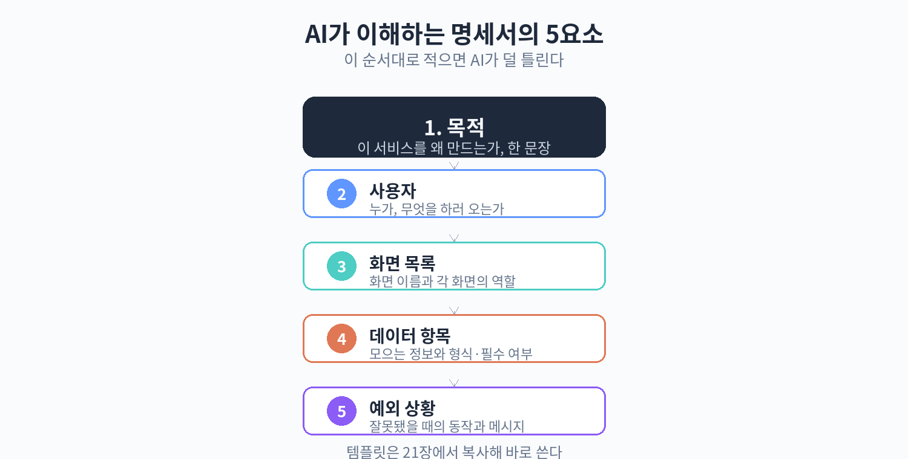

# 21. 기획서 템플릿: 화면 흐름도·데이터 항목·예외 상황

20장에서 명세서의 5요소를 배웠다. 이 장에서는 그중 실무에서 가장 자주 쓰는 3가지(화면 흐름도·데이터 항목·예외 상황)를 템플릿 형태로 제공한다. 템플릿은 빈칸만 채우면 되도록 만들었고, 각각에 카페 주문 앱 예시를 채운 완성본도 함께 실었다. 빈 템플릿을 복사해서 내 프로젝트에 맞게 고쳐 쓰면 된다.

## 템플릿 (a): 화면 흐름도

화면 흐름도는 "어떤 화면이 있고, 거기서 어디로 가는가"를 정리한 표다. 화면명, 그 화면의 역할, 다음 화면, 뒤로 가기 동작을 적는다. 뒤로 가기까지 적어두는 이유는 AI가 화면 전환 버튼을 빠뜨리는 실수를 막기 위해서다.

### 빈 템플릿

```
[화면 흐름도]

| 화면명 | 역할 | 다음 화면 | 뒤로 가기 |
|--------|------|-----------|-----------|
|        |      |           |           |
|        |      |           |           |
|        |      |           |           |
```

### 카페 주문 앱 완성본

```
[화면 흐름도] - 오후의 쉼표 픽업 주문

| 화면명     | 역할                                     | 다음 화면 | 뒤로 가기              |
|------------|------------------------------------------|-----------|------------------------|
| 메뉴판     | 음료/디저트 탭, 메뉴 목록 표시            | 주문 확인 | (첫 화면이라 없음)     |
| 주문 확인  | 담은 메뉴 목록, 수량 조절, 픽업 시간 선택 | 주문 완료 | 메뉴판으로 돌아가기    |
| 주문 완료  | 주문 번호 표시, 픽업 안내                | (없음)    | 메뉴판으로 돌아가기    |
```

작성 요령은 다음과 같다. 화면명은 화면에 실제로 보이는 이름으로 짓는다. 역할은 그 화면에서 사용자가 하는 일을 한 문장으로 적는다. 다음 화면은 버튼을 눌렀을 때 이동하는 화면을 적고, 이동 조건이 있으면 함께 적는다(예: "주문하기 버튼 → 주문 완료"). 뒤로 가기는 브라우저 뒤로 가기가 아니라 화면 안의 '돌아가기' 동작을 말한다.

화면이 5개를 넘어가면 표가 길어지는데, 그래도 전부 적는 게 좋다. 화면 하나가 빠지면 AI는 그 화면을 만들지 않거나, 엉뚱한 곳에 기능을 끼워 넣는다.

## 템플릿 (b): 데이터 항목표

데이터 항목표는 "이 화면(기능)에서 어떤 정보를 다루는가"를 정리한 표다. 항목명, 형식, 필수 여부, 예시를 적는다. 형식은 '글자·숫자·날짜·시간·참/거짓' 정도만 구분하면 충분하다. 개발 용어로 '문자열'이니 '정수'니 하는 말을 쓸 필요는 없다.

### 빈 템플릿

```
[데이터 항목표]

| 항목명 | 형식 | 필수 여부 | 예시 |
|--------|------|-----------|------|
|        |      |           |      |
|        |      |           |      |
|        |      |           |      |
```

### 카페 주문 앱 완성본

```
[데이터 항목표] - 주문 정보

| 항목명     | 형식 | 필수 여부 | 예시               |
|------------|------|-----------|--------------------|
| 메뉴명     | 글자 | 필수      | 아이스 아메리카노  |
| 가격       | 숫자 | 필수      | 4500               |
| 수량       | 숫자 | 필수      | 2                  |
| 픽업 시간  | 시간 | 필수      | 14:30              |
| 요청 사항  | 글자 | 선택      | 얼음 적게 해주세요 |
| 주문 번호  | 글자 | 필수      | A-1023             |
```

작성 요령은 다음과 같다. 필수 여부는 '꼭 있어야 다음으로 넘어가는가'로 판단한다. 요청 사항처럼 없어도 주문이 되는 것은 선택으로 둔다. 예시 칸은 AI가 형식 감을 잡는 데 큰 도움이 된다. 특히 날짜·시간 형식은 예시 하나로 오해를 막을 수 있다(14:30인지 오후 2시 30분인지).

한 가지 주의할 점은 화면 흐름도의 화면마다 데이터 항목표가 따로 있을 수 있다는 것이다. 메뉴 데이터와 주문 데이터는 항목이 다르다. 헷갈리면 표 제목에 "메뉴 정보", "주문 정보"처럼 범위를 적어둔다.



## 템플릿 (c): 예외 상황표

예외 상황표는 "이상한 일이 생기면 어떻게 할 것인가"를 정리한 표다. 상황, 기대 동작, 오류 메시지를 적는다. 오류 메시지까지 미리 정해두면 AI가 제멋대로 문구를 만드는 일이 줄어든다.

### 빈 템플릿

```
[예외 상황표]

| 상황 | 기대 동작 | 오류 메시지 |
|------|-----------|-------------|
|      |           |             |
|      |           |             |
|      |           |             |
```

### 카페 주문 앱 완성본

```
[예외 상황표] - 오후의 쉼표 픽업 주문

| 상황                              | 기대 동작                          | 오류 메시지                              |
|-----------------------------------|------------------------------------|------------------------------------------|
| 품절 메뉴를 담으려고 할 때        | 담기 버튼 비활성화, 품절 표시 유지 | (버튼이 안 눌리므로 메시지 없음)          |
| 픽업 시간을 현재보다 이른 시간으로| 다시 선택하도록 안내 표시          | 현재 시간 이후로 선택해 주세요            |
| 메뉴를 하나도 안 담고 주문하기    | 주문 화면으로 넘어가지 않음        | 메뉴를 1개 이상 담아 주세요              |
| 수량을 0으로 만들 때              | 해당 메뉴를 담은 목록에서 제거     | (삭제되므로 메시지 없음)                 |
```

작성 요령은 다음과 같다. 상황은 "언제"가 드러나게 적는다. 기대 동작은 화면이 어떻게 반응해야 하는지를 적는다. 오류 메시지는 손님이 실제로 보게 될 문장을 그대로 적는다. 반말과 존댓말이 섞이지 않게 미리 정해두면 좋다.

예외를 전부 적으려고 하면 끝이 없다. 기준은 "자주 일어날 것 같은 것"과 "일어나면 곤란한 것" 두 가지다. 위 예시의 4개처럼 핵심 몇 개만 적어도 AI가 나머지는 비슷한 방식으로 처리한다.

## 템플릿 3종을 AI에게 건네는 방법

템플릿을 다 채웠으면 AI에게 이렇게 건넨다. 한 번에 3개를 다 붙여넣어도 되고, 화면 흐름도부터 하나씩 건네도 된다.

```
아래 명세서를 보고 카페 픽업 주문 웹페이지를 만들어줘.

[화면 흐름도]
(표 붙여넣기)

[데이터 항목표]
(표 붙여넣기)

[예외 상황표]
(표 붙여넣기)
```

AI가 "이 부분이 모호하다"고 질문하면 그 부분을 템플릿에 추가하고 다시 건넨다. 명세서는 한 번 쓰고 끝나는 게 아니라 AI와 주고받으며 다듬어지는 문서다.

## 다음 단계로 넘어가기 전에 확인할 것

세 템플릿을 다 채웠다면 아래 3가지를 점검한다.

- 화면 흐름도의 모든 화면에 '뒤로 가기'가 적혀 있는가. 첫 화면이 아닌데 뒤로 가기가 비어 있으면 추가한다.
- 데이터 항목표의 필수 항목이 화면에서 실제로 입력받을 수 있는가. 화면에 입력 칸이 없는데 필수로 되어 있으면 둘 중 하나를 고친다.
- 예외 상황표의 오류 메시지가 손님 입장에서 이해되는 말인가. "유효하지 않은 입력" 같은 말은 "메뉴를 1개 이상 담아 주세요"처럼 고친다.

이 점검이 끝나면 22장에서 내 프로젝트에 맞는 AI 코딩 도구를 고른다. 도구를 고른 뒤에는 30장에서 이 명세서를 작은 단위로 나누어 AI에게 시키는 방법을 배운다.

## 템플릿 작성 시 자주 묻는 질문

### 화면이 몇 개인지 아직 모르겠는데 어떡하죠?

2~3개의 큰 화면부터 적는다. 카페 주문 앱이면 "메뉴판, 주문 확인, 주문 완료"처럼 가장 뼈대가 되는 것만 먼저 적고, 나중에 "사장님용 주문 목록 화면이 필요하네" 싶으면 추가한다. 템플릿은 처음부터 완성할 필요가 없고, 프로젝트가 진행되면서 늘어나는 문서다.

### 데이터 형식을 '글자·숫자'로만 적어도 되나요?

된다. AI가 코드를 만들 때는 알아서 정확한 형식을 정한다. 우리가 할 일은 "이 항목이 글자인지 숫자인지" 정도만 구분해 주는 것이다. 전화번호처럼 숫자로 보이지만 0으로 시작하고 계산하지 않는 것은 '글자'로 적는 게 낫다. 예시에 "010-1234-5678"을 적어두면 AI가 헷갈리지 않는다.

### 예외 상황이 안 떠올라요

"손님이 일부러 이상하게 쓴다면?"을 상상해 본다. 메뉴를 안 담고 주문하기, 수량을 100개로 하기, 픽업 시간을 어제로 하기 같은 것이다. 또는 "가게 입장에서 곤란한 경우"를 떠올린다. 품절 메뉴 주문, 영업시간 외 주문 같은 것이다. 이 두 방향으로 생각하면 3~4개는 금방 나온다.

## 메뉴 데이터 항목표 예시 추가

주문 정보 외에 메뉴 정보 표도 함께 보면 감이 더 잘 잡힌다. 카페 사장님이 메뉴를 등록·수정한다고 가정하고 항목을 정리한 것이다.

```
[데이터 항목표] - 메뉴 정보

| 항목명   | 형식 | 필수 여부 | 예시                  |
|----------|------|-----------|-----------------------|
| 메뉴명   | 글자 | 필수      | 아이스 아메리카노     |
| 가격     | 숫자 | 필수      | 4500                  |
| 카테고리 | 글자 | 필수      | 음료                  |
| 사진     | 글자 | 선택      | (이미지 파일 경로)    |
| 품절 여부| 참/거짓 | 필수   | 거짓                  |
| 설명     | 글자 | 선택      | 산미가 적은 고소한 원두 |
```

사진 항목의 형식을 '글자'로 적은 것이 이상해 보일 수 있다. 사진 자체가 저장되는 게 아니라 사진 파일의 위치(경로)가 글자로 저장되기 때문이다. 이런 식으로 "실제로 저장되는 형태"를 생각하며 적으면 된다. 잘 모르겠으면 예시만 정확히 적어도 AI가 알아서 처리한다.

## 템플릿 파일 보관 요령

작성한 템플릿 3종은 하나의 파일로 묶어서 보관한다. 파일 이름은 프로젝트 이름으로 짓는다. 예: "오후의쉼표-주문앱-명세서.md" — 한글 파일명은 이 책의 원고 규칙상 피했지만, 내 컴퓨터에 보관하는 파일은 한글 이름이 오히려 찾기 쉽다.

보관 위치는 AI 코딩 도구와 함께 쓰는 곳이 좋다. Claude Code나 Cursor처럼 폴더 단위로 작업하는 도구를 쓴다면 프로젝트 폴더 안에 "명세서" 폴더를 만들어 넣는다. v0나 Lovable처럼 브라우저에서 쓰는 도구라면 필요할 때마다 복사해서 붙여넣는다.

명세서를 고칠 때는 날짜를 적어둔다. 예: "2026-10-14: 픽업 시간 간격을 10분에서 30분으로 변경". 나중에 "왜 이렇게 바뀌었지?" 하고 헷갈리는 일을 막아준다. 32장에서 다루는 백업 습관과 함께 쓰면 변경 이력이 깔끔하게 남는다.

## 화면 흐름도를 그리는 순서

빈 화면에서 시작할 때 막막하면 아래 순서대로 한다.

1. 첫 화면을 정한다. 손님이 가장 먼저 보는 화면이다. 카페 주문 앱이면 메뉴판이다.
2. 첫 화면에서 누를 수 있는 버튼(또는 탭)을 적는다. "주문 확인으로 가기", "카테고리 탭" 같은 것이다.
3. 버튼마다 도착하는 화면을 적는다. 도착한 화면에서도 2단계를 반복한다.
4. 더 이상 갈 곳이 없을 때까지 반복한다. 보통 3~6개 화면에서 끝난다.

이렇게 하면 "화면이 몇 개인지 모르겠다"는 막막함이 사라진다. 버튼을 따라가다 보면 화면이 자연스럽게 나온다.

## 데이터 항목표에서 자주 빠지는 항목들

처음 쓸 때 빠뜨리기 쉬운 항목 3가지다.

- 주문 번호, 예약 번호 같은 식별자. 화면에는 안 보이지만 뒤에서 꼭 필요하다.
- 등록 날짜·수정 날짜. "언제 만들어졌는지"는 나중에 꼭 필요해진다.
- 상태 값. 주문이면 "준비 중/완료", 메뉴면 "판매 중/품절" 같은 것이다.

잘 모르겠으면 AI에게 물어본다. "이 데이터 항목표에서 빠진 게 있냐"고 하면 AI가 식별자나 상태 값을 제안한다. 제안받은 것을 표에 추가하면 된다.

## 예외 상황표를 먼저 쓰는 경우

보통은 화면과 데이터를 먼저 정리하지만, 반대로 예외부터 생각하는 게 편한 사람도 있다. "손님이 이상하게 쓰면 어떻게 되지?"부터 떠올리고, 그걸 막기 위한 화면과 데이터를 정하는 방식이다.

예를 들어 "품절 메뉴를 주문하면 곤란하다"는 예외부터 적는다. 그러면 "품절 표시"라는 화면 요소와 "품절 여부"라는 데이터 항목이 필요해진다. 예외 → 화면 → 데이터 순서로 거꾸로 채워도 템플릿은 똑같이 동작한다. 편한 순서대로 쓰면 된다.
