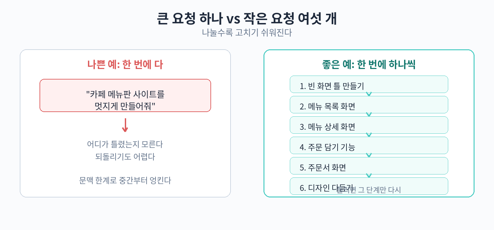

# 30. 작은 단위로 나누어 시키기

Part 2에서 명세서를 쓰고 도구를 골랐다. 이제 AI에게 실제로 일을 시킬 차례다. 여기서 가장 중요한 원칙 하나가 있다. "한 번에 하나씩"이다. 욕심내서 한 번에 큰 것을 시키면, 십중팔구 어딘가가 망가진다. 이 장에서는 왜 작은 단위로 나눠야 하는지, 어떻게 나누는지, 그리고 카페 메뉴판 사이트를 6단계로 나눈 실제 요청 문장을 다룬다.

## 한 번에 큰 것을 시키면 망가지는 이유

### 이유 1: AI의 문맥 한계

AI는 한 번에 기억할 수 있는 분량에 한계가 있다. 이를 '문맥'이라고 한다. 화면 10개짜리 앱을 한 번에 시키면, AI는 앞부분을 만들 때 뒷부분을 잊어버린다. 먼저 만든 화면과 나중에 만든 화면의 디자인이 달라지거나, 같은 기능을 두 번 만들거나, 반대로 빼먹는 일이 생긴다.

사람도 마찬가지다. 하루 일과를 한 번에 외우라고 하면 앞부분만 기억나지 않는가. AI에게도 "한 번에 외울 수 있는 분량"이 있다. 작은 단위로 나누는 것은 AI의 기억 용량을 배려하는 일이다.

### 이유 2: 한 번에 바뀌는 파일이 많으면 검증 불가

AI가 한 번에 20개 파일을 만들었다고 치자. 그중에 오류가 하나 숨어 있으면 어디서부터 손봐야 할지 알 수 없다. 비개발자인 우리는 코드를 읽고 범인을 찾을 수 없다. 하지만 한 번에 1~2개 파일만 바뀌었다면, "아까 그 화면이 문제네" 하고 범위가 좁혀진다.

작게 나누면 "어디까지는 잘 됐고, 어디서부터 망가졌다"가 명확해진다. 이건 31장의 디버깅에서도 그대로 이어지는 원칙이다.

## 나누기의 원칙 2가지

### 원칙 1: 한 요청 = 한 화면 또는 한 기능

요청 하나에는 화면 하나, 또는 기능 하나만 담는다. "메뉴판 화면 만들어줘"는 좋은 요청이다. "메뉴판 화면 만들고 주문 기능도 넣고 사장님 화면도 만들어줘"는 나쁜 요청이다. 3개가 섞이면 AI가 뭐부터 해야 할지, 각각을 얼마나 공들여야 할지 판단하지 못한다.

### 원칙 2: 각 요청 후 눈으로 확인

요청을 보내고 결과물이 나오면, 다음 요청을 보내기 전에 눈으로 확인한다. 화면이 떴는지, 버튼이 눌리는지, 글자가 깨지지 않았는지 본다. 확인하지 않고 다음 요청을 보내면, 앞 단계의 오류가 뒤 단계까지 번진다. "1단계가 틀렸는데 2단계를 그 위에 쌓은" 상황이 되면 되돌리기가 어려워진다.

확인 방법은 간단하다. 미리보기 화면을 열고 클릭해 보는 것이다. 코드를 읽을 필요는 없다. 손님이 쓸 것처럼 만져보면 된다.



## 실전 예시: 카페 메뉴판 사이트 6단계

20~21장에서 만든 "오후의 쉼표" 픽업 주문 명세서를 기준으로, AI에게 보낼 요청을 6단계로 나눈 것이다. 각 요청 문장은 그대로 복사해서 써도 된다.

### 1단계: 메뉴판 화면 뼈대

```
[명세서 붙여넣기]

1단계: 메뉴판 화면의 뼈대만 만들어줘.
음료/디저트 탭과 메뉴 목록(메뉴명·가격)까지만.
사진과 주문 기능은 다음 단계에서 할게.
```

완료 기준: 메뉴판 화면이 뜨고, 탭을 누르면 음료/디저트 목록이 바뀐다.

### 2단계: 메뉴 사진과 품절 표시

```
2단계: 메뉴판 화면에 메뉴 사진을 넣고,
품절인 메뉴에는 "품절" 표시를 해줘.
사진은 임시 이미지로 넣어줘.
```

완료 기준: 각 메뉴에 사진이 보이고, 품절 메뉴가 구분된다.

### 3단계: 담기 기능

```
3단계: 메뉴 옆에 "담기" 버튼을 만들어줘.
담은 메뉴는 화면 위쪽 장바구니에 개수가 표시돼.
품절 메뉴의 담기 버튼은 안 눌리게 해줘.
```

완료 기준: 담기를 누르면 장바구니 개수가 올라가고, 품절 메뉴는 안 담긴다.

### 4단계: 주문 확인 화면

```
4단계: 주문 확인 화면을 만들어줘.
담은 메뉴 목록, 수량 조절(+/- 버튼),
픽업 시간 선택(30분 단위), 요청 사항 입력 칸이 필요해.
```

완료 기준: 장바구니에서 넘어가면 담은 목록이 보이고, 수량과 시간을 바꿀 수 있다.

### 5단계: 주문 완료 화면

```
5단계: 주문 완료 화면을 만들어줘.
주문 번호를 크게 보여주고,
"준비되면 문자로 알려드립니다" 안내를 넣어줘.
```

완료 기준: 주문하기를 누르면 주문 번호가 표시된다.

### 6단계: 예외 처리 다듬기

```
6단계: 예외 상황을 처리해줘.
- 메뉴를 안 담고 주문하기를 누르면 "메뉴를 1개 이상 담아 주세요" 표시
- 픽업 시간을 현재보다 이른 시간으로 고르면
  "현재 시간 이후로 선택해 주세요" 표시
```

완료 기준: 각 예외 상황에서 안내 문구가 뜬다.

## 각 단계의 완료 기준을 쓰는 이유

위 6단계마다 "완료 기준"을 적어둔 것을 눈여겨보자. 완료 기준은 "이 화면이 뜨면 다음으로" 같은 한 줄이다. 이걸 적어두면 두 가지가 좋아진다.

첫째, 확인이 빨라진다. 뭘 봐야 하는지 정해져 있으니 미리보기를 열고 1분이면 확인이 끝난다. "뭔가 이상한데 뭐가 이상한지 모르겠네" 하는 시간이 줄어든다.

둘째, AI에게 다시 시킬 때 기준이 된다. 완료 기준을 못 맞췄으면 그 단계 안에서 고치면 된다. "3단계가 덜 됐으니 3단계를 다시 해줘"라고 하면 AI도 범위를 안다. 다음 단계로 넘어가지 않고 그 자리에서 고치는 게 전체 일정을 지키는 길이다.

## 나누는 단위의 감 잡기

처음에는 "이게 한 단계로 적당한가?"가 헷갈린다. 기준은 "결과를 눈으로 확인할 수 있는가"다. 화면 하나가 뜨거나, 버튼 하나가 동작하거나 하면 한 단계로 적당하다. "데이터베이스 구조 설계"처럼 눈에 안 보이는 것은 비개발자가 직접 시킬 일이 거의 없으니 AI에게 맡기되, 명세서의 데이터 항목표를 근거로 "이 항목들이 저장되게 해줘" 정도로만 말하면 된다.

너무 잘게 나누는 것도 피한다. "버튼 색 바꾸기" 하나하나를 단계로 나누면 요청이 수십 개가 된다. 작은 수정은 한 단계 안에서 묶는다. "메뉴판 화면의 글자 크기와 버튼 색을 다듬어줘"처럼 관련 있는 수정은 한 번에 시켜도 된다.

다음 장에서는 이렇게 나눈 단계에서 문제가 생겼을 때, AI에게 고치게 하는 대화법을 다룬다.

## 나누지 않고 시켰을 때 생기는 실제 사례

"오후의 쉼표" 사장님이 명세서 없이 한 번에 이렇게 시켰다고 가정해 보자.

```
카페 픽업 주문 앱 만들어줘.
메뉴판, 주문, 주문 완료 화면이 필요하고
품절 처리도 되게 해줘.
```

AI는 3개 화면을 한 번에 만들었다. 그런데 문제가 생겼다. 주문 확인 화면에서 수량을 바꾸면 장바구니 개수가 안 바뀌는 오류가 났다. 어디서부터 손봐야 할지 알 수 없었다. AI에게 "수량 오류 고쳐줘"라고 했더니 장바구니는 고쳐졌는데 이번에는 픽업 시간 선택이 안 됐다. 고치면 다른 데가 망가지는 일이 반복됐다. 결국 처음부터 다시 만드는 데 3일이 걸렸다.

반면 6단계로 나눴다면, 3단계(담기 기능)에서 수량 문제를 그 자리에서 발견하고 고쳤을 것이다. 4단계로 넘어가기 전에 3단계가 완성됐으니, 4단계의 문제는 4단계 안에서만 찾으면 된다. 나누기는 "문제의 용의자를 줄이는" 효과가 있다.

## 단계별 대화 예시 전문

6단계 중 3단계(담기 기능)를 AI와 주고받는 실제 대화가 어떻게 흘러가는지 보여준다.

나:
```
[명세서 붙여넣기]

3단계: 메뉴 옆에 "담기" 버튼을 만들어줘.
담은 메뉴는 화면 위쪽 장바구니에 개수가 표시돼.
품절 메뉴의 담기 버튼은 안 눌리게 해줘.
```

AI: (작업 후) "담기 버튼과 장바구니 표시를 추가했습니다. 확인해 보세요."

나: (미리보기를 열어본다. 담기를 누르니 장바구니에 1이 뜬다. 품절 메뉴의 버튼은 안 눌린다.)
```
잘 됐어. 3단계 완료.
```

이렇게 짧게 끝나는 게 정상이다. 확인하고 "완료"라고 말하면 AI도 다음 단계를 준비한다. 확인 없이 "다음 해줘"만 반복하면 앞 단계의 문제를 놓친다.

수정이 필요했던 경우의 대화는 이렇다.

나: (미리보기를 열어본다. 담기 버튼이 너무 작다.)
```
3단계 수정: 담기 버튼을 지금보다 2배 크게 해줘.
다른 건 건드리지 말고.
```

AI: (수정 후) "버튼 크기를 키웠습니다."

나: (확인한다. 잘 됐다.)
```
3단계 완료.
```

수정은 그 단계 안에서 끝낸다. "버튼 크기" 하나를 고치려고 전체를 다시 만들지 않는다.

## 단계가 막혔을 때의 대처

### AI가 단계를 이해 못 할 때

"3단계가 뭔지 모르겠어요"라는 답이 오면, 명세서를 다시 붙여넣는다. 대화가 길어지면 AI가 앞의 명세서를 잊어버리기 때문이다. 그래도 모르면 3단계를 더 잘게 나눈다. "3-1단계: 담기 버튼만 만들어줘", "3-2단계: 장바구니 개수 표시를 만들어줘"처럼 말이다.

### 결과물이 명세서와 다를 때

"품절 메뉴의 담기 버튼이 눌려요"처럼 구체적으로 지적한다. 그리고 명세서의 해당 부분을 인용한다. "명세서 예외 상황표에 '담기 버튼 비활성화'라고 적혀 있어"라고 하면 AI가 기준을 확인하고 고친다.

### 한 단계에서 30분 넘게 헤맬 때

31장의 3번 반복 규칙을 적용한다. 같은 문제를 3번 고치라고 했는데도 안 되면 멈춘다. 그 단계는 건너뛰고 다음 단계로 가거나, 하루 쉬고 다시 본다. 막힌 단계에 매달리면 전체가 멈춘다.

## 나누기 체크리스트

AI에게 요청을 보내기 전에 아래를 확인한다.

- 이번 요청에 화면 하나 또는 기능 하나만 들어 있는가.
- 명세서를 함께 붙여넣었는가(대화가 길어졌다면 다시).
- 완료 기준을 한 줄로 적어두었는가.
- 이전 단계의 완료 기준을 맞췄는가(안 맞췄으면 이전 단계로 돌아간다).

이 체크리스트를 요청마다 반복하면, 프로젝트가 끝날 때까지 "어디까지 됐는지"가 항상 명확하다. 32장의 백업 습관과 함께 쓰면 "어디까지 됐고, 그게 어디에 저장됐는지"까지 관리된다.
