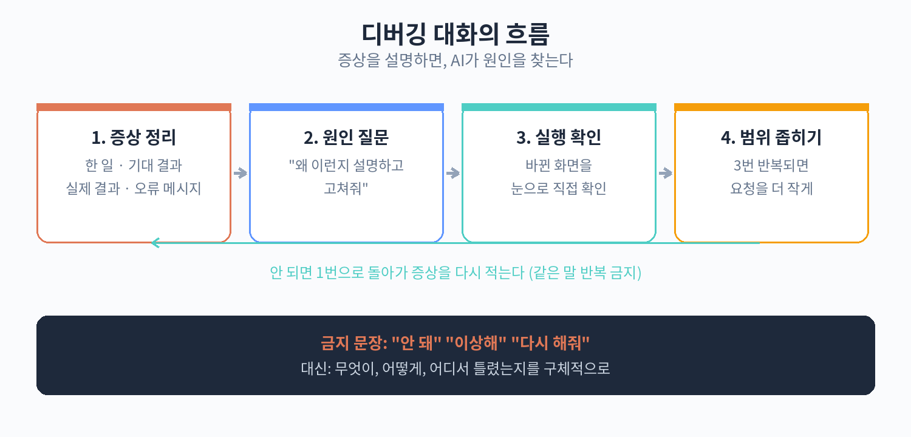

# 31. 안 될 때 고치게 하는 디버깅 대화법

30장대로 작은 단위로 시켰는데도 문제가 생긴다. 버튼이 안 눌리거나, 화면이 하얗게 나오거나, 글자가 깨진다. 이럴 때 당황해서 "안 돼요, 고쳐줘"라고만 하면 AI도 어쩔 줄을 모른다. 디버깅(오류를 찾아 고치는 일)은 증상을 정확히 전달하는 것에서 시작한다. 이 장에서는 증상 설명 4요소, 나쁜 질문 vs 좋은 질문 3쌍, 고칠 때 덧붙일 말, 3번 반복 규칙, 흔한 오류 메시지 해석표를 다룬다.

## 증상을 설명하는 4요소

AI에게 오류를 설명할 때는 다음 4가지를 순서대로 적는다. 이 4가지만 갖춰도 AI가 원인을 찾을 확률이 크게 올라간다.

### 1. 무엇을 했는지

문제를 일으킨 행동을 적는다. "주문 확인 화면에서 주문하기 버튼을 눌렀어요"처럼 구체적으로 적는다. "그냥 안 돼요"는 행동이 빠져 있다.

### 2. 무엇이 나와야 하는지

정상이라면 어떻게 돼야 하는지를 적는다. "주문 완료 화면으로 넘어가야 해요"처럼 기대 결과를 적는다. 이게 없으면 AI는 "지금 상태가 정상인지 비정상인지"를 모른다.

### 3. 실제로 무엇이 나오는지

지금 눈에 보이는 상태를 적는다. "아무 일도 안 일어나요", "화면이 하얗게 돼요", "주문 완료 화면은 뜨는데 주문 번호가 안 보여요"처럼 본 그대로를 적는다.

### 4. 오류 메시지 전문

화면에 빨간 글씨나 영어 문장이 떴다면 그대로 복사해서 붙여넣는다. "전문"이 중요하다. 앞부분만 잘라서 주면 단서가 사라진다. 영어라서 읽기 싫어도 그대로 붙여넣으면 AI가 해석한다. 절대 고치지 말고 복사 그대로 준다.

### 4요소를 합친 예시

```
1. 무엇을 했는지: 주문 확인 화면에서 "주문하기" 버튼을 눌렀어요.
2. 무엇이 나와야 하는지: 주문 완료 화면으로 넘어가야 해요.
3. 실제로 무엇이 나오는지: 버튼을 눌러도 아무 일도 안 일어나요.
4. 오류 메시지: (없음)
```

이렇게 적으면 AI는 "버튼 클릭이 동작하지 않는 문제"로 좁혀서 원인을 찾는다. 4가지 중 하나라도 빠지면 AI가 되묻느라 시간이 걸린다.

## 나쁜 질문 vs 좋은 질문 3쌍

### 1쌍: 증상 설명

나쁜 질문:
```
안 돼요. 고쳐줘요.
```

좋은 질문:
```
주문 확인 화면에서 "주문하기" 버튼을 눌렀는데
아무 일도 안 일어나요.
주문 완료 화면으로 넘어가야 하는데 그대로예요.
오류 메시지는 안 떴어요.
```

차이: 좋은 질문에는 4요소가 들어 있다. AI가 바로 원인 찾기에 들어갈 수 있다.

### 2쌍: 화면 깨짐

나쁜 질문:
```
화면이 이상해요.
```

좋은 질문:
```
메뉴판 화면에서 메뉴 사진이 안 보여요.
메뉴명과 가격은 정상으로 나오는데 사진 자리만 빈 네모로 나와요.
원래는 각 메뉴의 사진이 보여야 해요.
```

차이: "이상해요"는 증상이 아니다. "무엇이, 어떻게 이상한지"를 적어야 한다. 정상인 부분(메뉴명·가격은 나옴)까지 적어주면 AI가 범위를 좁히는 데 도움이 된다.

### 3쌍: 고쳐달라고 할 때

나쁜 질문:
```
오류 났어요. (오류 메시지 붙여넣기)
```

좋은 질문:
```
아래 오류가 났어요. 원인을 설명하고 고쳐줘.
다른 부분은 건드리지 말고 이 오류만 고쳐줘.

(오류 메시지 전문 붙여넣기)
```

차이: 좋은 질문에는 "원인을 설명하고"와 "다른 부분은 건드리지 말고"가 붙어 있다. 이 두 문장의 효과는 다음 절에서 설명한다.



## 고쳐달라고 할 때 덧붙일 말 2가지

### "원인을 설명하고 고쳐줘"

이 말을 붙이면 AI가 고치기 전에 원인을 먼저 설명한다. 원인을 알면 두 가지가 좋다. 첫째, 같은 실수를 다음에 안 하게 된다. 둘째, AI의 설명이 이상하면(내 상황과 안 맞으면) 고치기 전에 멈출 수 있다. "원인 설명 없이 일단 고쳐봐"는 빠르지만, 뭐가 문제였는지 모른 채 넘어가게 된다.

### "다른 부분은 건드리지 말고"

AI는 고치면서 주변 코드를 함께 손보는 경향이 있다. "이참에 여기도 정리할게요" 식이다. 그러다 잘 되던 다른 부분이 망가진다. 이 말을 붙이면 수정 범위가 오류 하나로 묶인다. 30장의 "한 요청 = 한 화면 또는 한 기능" 원칙과 같은 맥락이다.

## 3번 반복 규칙

같은 오류가 3번 반복되면 멈추고 범위를 줄인다. AI에게 같은 말을 3번 했는데도 안 고쳐지면, 그 방향으로는 해결이 안 된다는 신호다. 계속 "다시 고쳐줘"를 반복하면 시간만 간다.

이때 할 일은 다음과 같다.

1. 일단 멈춘다. 같은 요청을 4번째로 보내지 않는다.
2. 범위를 줄인다. "주문 기능 전체"가 아니라 "주문하기 버튼 클릭" 하나로 좁힌다.
3. 새 대화로 시작한다. 지금까지의 대화가 길어져서 AI가 헷갈리는 경우도 있다. 증상 4요소와 관련 파일(화면)만 가지고 새 대화를 연다.
4. 그래도 안 되면 우회한다. "버튼이 안 되면 일단 링크로 연결해줘"처럼 돌아가는 길을 찾는다. 돌아가는 것도 안 돌아가는 것보다 낫다.

3번이라는 숫자에 과학적 근거는 없다. 다만 경험상 3번이면 "이 방향이 아니다"를 판단하기에 충분하다.

## 흔한 오류 메시지 5종의 쉬운 해석표

오류 메시지는 영어로 뜨는 경우가 많다. 아래 표는 자주 보는 5종을 비개발자용으로 풀어쓴 것이다. 메시지를 그대로 복사해서 AI에게 주면 되지만, 대략의 의미라도 알면 덜 당황한다.

| 오류 메시지(예시) | 쉬운 해석 | 할 일 |
|---|---|---|
| 404 Not Found | 찾는 페이지(화면)가 없음 | 화면 이름·주소가 맞는지 확인. AI에게 "이 화면으로 가는 길이 끊긴 것 같다"고 전달 |
| Cannot read properties of undefined | 없는 데이터를 읽으려 함 | "어떤 데이터를 못 찾은 거냐"고 AI에게 묻기. 데이터 항목표(21장)와 대조 |
| Failed to fetch | 서버에서 데이터를 못 가져옴 | 인터넷 연결 확인 후 AI에게 메시지 전문 전달 |
| SyntaxError: Unexpected token | 코드에 오타·기호 오류 | 직접 고치려 하지 말고 메시지 전문을 AI에게 전달 |
| Port already in use | 이미 실행 중인 게 있음 | 미리보기 서버를 껐다 켜보기. 안 되면 AI에게 "포트 충돌"이라 전달 |

표의 "할 일"은 직접 해결하라는 뜻이 아니라 AI에게 전달할 말을 정리한 것이다. 비개발자가 오류를 직접 고칠 필요는 없다. 할 일은 "메시지 전문을 복사해서, 증상 4요소와 함께 AI에게 주는 것"이다.

## 디버깅 대화 체크리스트

문제가 생겼을 때 아래 순서대로 한다.

1. 증상 4요소를 적는다(했는지·나와야 하는지·실제로 나오는지·오류 메시지).
2. "원인을 설명하고 고쳐줘. 다른 부분은 건드리지 말고"를 붙여서 AI에게 보낸다.
3. 고친 뒤에는 눈으로 확인한다(30장의 원칙 2).
4. 같은 오류가 3번 반복되면 멈추고 범위를 줄이거나 새 대화로 시작한다.

이 흐름에 익숙해지면 오류가 나도 당황하지 않게 된다. 오류는 실패가 아니라 "AI에게 더 정확히 말할 기회"다. 다음 장에서는 작업물을 안전하게 보관하는 최소 습관(커밋·백업·롤백)을 다룬다.

## 디버깅 대화 실제 예시 전문

31장의 원칙들이 실제 대화에서 어떻게 쓰이는지, 처음부터 끝까지 보여준다.

나: (주문하기 버튼이 안 눌린다.)
```
1. 무엇을 했는지: 주문 확인 화면에서 "주문하기" 버튼을 눌렀어요.
2. 무엇이 나와야 하는지: 주문 완료 화면으로 넘어가야 해요.
3. 실제로 무엇이 나오는지: 버튼을 눌러도 아무 일도 안 일어나요.
4. 오류 메시지: (없음)

원인을 설명하고 고쳐줘.
다른 부분은 건드리지 말고 이 문제만 고쳐줘.
```

AI: "원인은 주문하기 버튼에 화면 이동 동작이 연결되지 않은 것입니다. 버튼 클릭 시 주문 완료 화면으로 이동하도록 연결했습니다. 장바구니와 픽업 시간 입력은 건드리지 않았습니다."

나: (미리보기에서 주문하기를 눌러본다. 주문 완료 화면으로 넘어간다.)
```
고쳐졌어. 고마워.
```

이 대화의 포인트는 3가지다. 증상 4요소가 다 들어갔고, "원인을 설명하고"가 붙었고, "다른 부분은 건드리지 말고"가 붙었다. AI의 답변에도 원인과 수정 범위가 명시됐다. 이런 대화가 쌓이면 나중에는 증상만 적어도 AI가 알아서 원인을 설명한다.

## 오류 메시지 복사하는 법

4요소 중 "오류 메시지 전문"은 복사가 핵심이다. 베껴 쓰면 오타가 나고, 앞부분만 따오면 단서가 사라진다. 도구별로 이렇게 복사한다.

- 브라우저 미리보기에서 빨간 글씨가 떴을 때: 글자를 드래그해서 복사(Ctrl+C)한다. 길면 전체를 복사한다.
- 브라우저 개발자 도구(F12)의 Console 탭: 오류가 길게 나올 때 여기를 연다. 빨간 줄을 우클릭 → Copy 하면 전문이 복사된다.
- Claude Code 터미널: 오류가 터미널에 출력되면 마우스로 드래그해서 복사한다.

복사한 메시지는 코드 블록(```) 안에 붙여넣으면 모양이 깨지지 않는다.

```
TypeError: Cannot read properties of undefined (reading 'name')
    at ...
```

## AI의 답변이 이상할 때

"원인을 설명하고 고쳐줘"라고 했는데 AI의 설명이 내 상황과 안 맞을 때가 있다. 예를 들어 "주문 데이터가 없어서 그래요"라는데, 나는 데이터를 다 넣은 경우다. 이럴 때는 반박한다.

```
아니야, 주문 데이터는 다 들어 있어.
메뉴를 2개 담고 픽업 시간도 골랐어.
다른 원인을 찾아봐.
```

AI는 맞장구를 치는 경향이 있어서, 틀린 원인을 그럴듯하게 설명할 때가 있다. 내 눈으로 확인한 사실(데이터는 들어 있다)이 AI의 설명보다 우선이다. 확신이 서면 밀고 나간다.

## 고쳤는데 또 망가졌을 때

고쳤다고 해서 끝이 아니다. 고친 뒤에는 반드시 그 기능을 다시 써본다. 그리고 고치기 전에는 잘 되던 다른 기능도 한 번씩 눌러본다. "다른 부분은 건드리지 말고"라고 했어도 확인은 내 몫이다.

확인하다가 다른 곳이 망가진 것을 발견하면, 이렇게 말한다.

```
아까 고치기 전에는 픽업 시간 선택이 잘 됐는데,
지금은 안 돼.
주문하기 버튼 수정하면서 건드린 것 같아.
픽업 시간 선택만 원래대로 돌려줘.
```

"아까는 됐는데 지금은 안 돼"라는 말이 핵심 정보다. AI는 이 말을 듣고 최근 수정 내역을 되짚는다.

## 디버깅할 때 하지 말아야 할 것 3가지

1. 오류 메시지를 고쳐서(요약해서) 전달하지 않는다. 전문 그대로 준다.
2. 화가 나서 "제대로 해!"라고만 말하지 않는다. 감정보다 증상 4요소가 효과적이다.
3. 안 고쳐진다고 단계를 건너뛰지 않는다. 30장의 원칙대로, 그 단계 안에서 해결하고 넘어간다. 단, 3번 반복 규칙에 걸리면 멈추고 범위를 줄인다.
