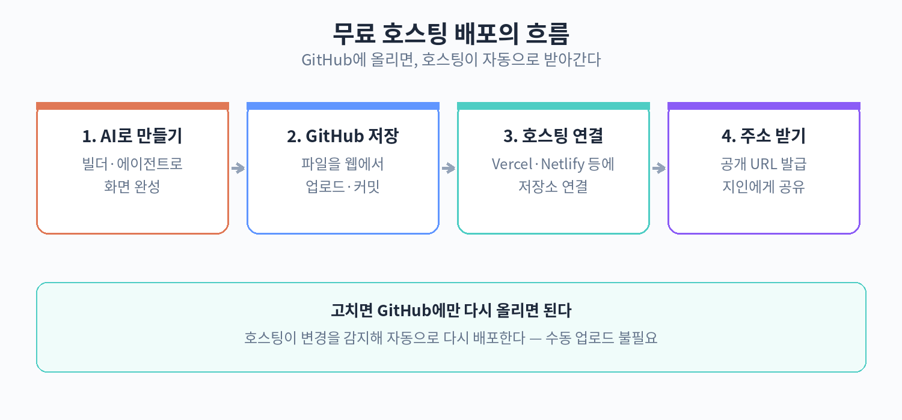

# 40. 프로젝트 1: 개인 포트폴리오·랜딩 페이지 만들기와 무료 배포

이 장에서는 하루 안에 끝낼 수 있는 실전 프로젝트를 다룬다.
목표는 하나다.
자신의 이름이나 사업이 걸린 웹 페이지 하나를 만들고, 인터넷에서 누구나 볼 수 있게 무료로 배포하는 것까지다.
앞의 장들에서 배운 명세서 작성, AI 빌더 사용, GitHub 관리, 무료 호스팅이 한 흐름으로 이어진다.

여기서 말하는 포트폴리오·랜딩 페이지는 거창한 것이 아니다.
예를 들면 이런 것이다.
프리랜서 디자이너의 작업물 소개 페이지, 동네 카페의 메뉴·위치 안내 페이지, 1인 사업자의 상담 신청 페이지. 방문자가 1분 안에 "이 사람이 뭘 하는 사람인지" 알 수 있으면 충분하다.

하루라는 기준은 이렇게 잡는다.
오전에 명세서를 쓰고 AI로 첫 화면을 만들고, 오후에 문구와 사진을 바꾸고 GitHub에 올린 뒤 배포한다.
도메인 연결(예: myname.com)은 이번 장에서 하지 않는다.
무료 호스팅 주소로도 충분히 공개할 수 있기 때문이다.

## 1단계: 명세서 1장 쓰기

제20장에서 배운 대로, 페이지 한 장짜리 명세서를 먼저 쓴다.
길게 쓸 필요가 없다.
다음 다섯 가지만 정한다.

1. 이 페이지의 주인은 누구인가 (이름 또는 상호)
2. 방문자에게 시키고 싶은 행동 하나 (전화 걸기, 상담 신청, 포트폴리오 보기)
3. 꼭 들어가야 하는 정보 (사진 3장, 연락처, 약력 5줄 등)
4. 분위기 (밝은 느낌, 차분한 느낌 등)
5. 없는 것 (온라인 결제, 회원 가입처럼 이번에 안 할 것)

예를 들어 카페 사장의 명세서는 이렇게 쓸 수 있다.

- 주인: 구산동 카페 '낮달'
- 목표 행동: 매장 위치 확인 후 방문
- 정보: 메뉴판 사진 2장, 주소·영업시간, 사장의 한 줄 소개
- 분위기: 따뜻하고 조용한
- 제외: 온라인 주문, 예약 시스템

명세서가 짧을수록 AI가 만드는 화면이 빗나갈 확률이 낮아진다.
두 페이지짜리 명세서는 이 프로젝트에서는 과하다.

### 이 단계에서 흔히 망가지는 지점

- 목표 행동을 두 개 이상 적는다. "상담도 받고, 구독도 받고, 인스타 팔로우도..." 식이다. 하나만 남기고 나머지는 지운다.
- 분위기를 추상적으로 쓴다. "감성적인 느낌"보다 "밝은 베이지 배경에 둥근 글씨"처럼 눈에 보이는 표현이 낫다.

## 2단계: AI 빌더로 첫 화면 생성

명세서가 준비됐으면 AI 빌더(v0, Lovable, Bolt 같은 화면 생성 도구)에 붙여넣고 생성을 요청한다.
요청 문장은 이렇게 구성한다.

"다음 명세서대로 한 페이지짜리 웹사이트를 만들어줘. [명세서 내용] 방문자의 목표 행동은 [상담 신청]이야. 사진 자리는 임시 이미지로 비워둬."

첫 생성 결과는 70점짜리라고 생각하면 된다.
색이 마음에 안 들고, 글자 크기가 어색하고, 문구가 어색하다.
괜찮다.
이 단계의 목적은 빈 화면을 없애는 것이지, 완성품을 뽑는 것이 아니다.

한 번에 다 고치려 하지 말고, 한 번에 하나씩만 요청한다.
"배경색을 베이지로 바꿔줘" 하고 결과를 보고, 다음에 "제목을 더 크게 해줘"라고 한다.
한 번에 다섯 가지를 시키면 그중 두세 개가 엉뚱하게 적용된다.

### 이 단계에서 흔히 망가지는 지점

- 첫 결과물이 마음에 안 든다고 처음부터 다시 만든다. 세 번 다시 만들면 오전이 끝난다. 수정 요청으로 고치는 쪽이 빠르다.
- 한글 문구가 기계 번역투로 나온다. 이 단계에서는 무시한다. 3단계에서 통째로 교체할 것이다.

## 3단계: 문구·사진 교체

이제 AI가 만든 화면의 껍데기를 내 것으로 바꾼다.
할 일은 두 가지뿐이다.

문구 교체: 페이지에 보이는 모든 문장을 내 말로 다시 쓴다.
AI가 쓴 "환영합니다!
최고의 서비스를 제공합니다" 같은 문장은 전부 지우고, 평소 손님에게 말하듯 쓴다.
카페라면 "오후 2시부터 5시까지는 조용해요.
책 읽기 좋아요." 같은 식이다.
가격, 영업시간, 연락처 같은 사실 정보는 이 단계에서 정확히 넣는다.

사진 교체: 임시 이미지를 실제 사진으로 바꾼다.
스마트폰으로 찍은 사진이면 충분하다.
단, 파일 이름은 영문으로 바꾼다.
menu1.jpg, shop-front.jpg 같은 식이다.
한글 파일명(메뉴판.jpg)은 배포 후 깨지는 원인이 된다.

사진 크기는 가로 1600픽셀 이하로 줄인다.
원본 그대로 올리면 페이지가 느리게 열린다.
스마트폰 기본 사진 앱의 크기 조절 기능으로 충분하다.

### 이 단계에서 흔히 망가지는 지점

- AI가 쓴 문구를 "그럴듯하니까" 그대로 둔다. 방문자는 어색한 문장을 바로 알아챈다.
- 사진 파일명을 한글 그대로 둔다. 내 컴퓨터에서는 잘 보이지만 배포 후 엑스박스로 깨진다.
- 사진을 원본 4000픽셀로 올린다. 모바일에서 페이지가 10초 넘게 걸린다.

## 4단계: GitHub에 올리기

완성된 페이지 파일들을 GitHub 저장소에 올린다.
제23장(GitHub 기초)에서 다룬 흐름 그대로다.

1. github.com에서 새 저장소를 만든다. 이름은 소문자 영문으로 짓는다. 예: my-cafe-page
2. 저장소를 비공개가 아닌 공개(public)로 둔다. 무료 호스팅 중 일부는 공개 저장소만 연결된다.
3. 파일들을 업로드한다. 보통 index.html 하나와 이미지 폴더 하나면 된다.

파일 구조는 단순하게 유지한다.

- my-cafe-page/
  - index.html (메인 페이지)
  - images/ (사진 폴더)
    - menu1.jpg
    - shop-front.jpg

깊은 폴더 구조(폴더 안의 폴더 안의 폴더)는 만들지 않는다.
이미지 경로가 복잡해질수록 배포 후 깨질 확률이 올라간다.

### 이 단계에서 흔히 망가지는 지점

- 저장소를 비공개(private)로 만든다. 배포 단계에서 호스팅 서비스가 파일을 못 읽는다.
- images 폴더를 빼먹고 html만 올린다. 로컬에서는 잘 보이지만 배포 후 사진이 전부 깨진다.
- 파일명에 대문자와 소문자를 섞는다. Menu1.jpg와 menu1.jpg는 내 컴퓨터(윈도우)에서는 같은 파일이지만, 배포 서버(리눅스)에서는 다른 파일이다.

## 5단계: 무료 호스팅으로 배포

이제 저장소를 무료 호스팅 서비스에 연결한다.
네 가지 중 하나를 고르면 된다.
기능 차이는 거의 없으니, 처음 들어보는 이름 하나를 골라 끝까지 가면 된다.

- Vercel: GitHub 계정으로 로그인 후 저장소를 고르면 바로 배포된다. 미리보기 주소가 자동 생성된다.
- Netlify: 방식은 Vercel과 비슷하다. 드래그 앤 드롭으로 폴더를 올리는 방법도 있다.
- Cloudflare Pages: Cloudflare 계정이 필요하지만 속도가 안정적이다.
- GitHub Pages: 저장소 설정에서 켜는 방식이라 외부 가입이 필요 없다.

공통 흐름은 이렇다.
호스팅 서비스에 GitHub 계정으로 로그인한다.
배포할 저장소를 선택한다.
배포 버튼을 누른다.
1~2분 뒤에 공개 주소가 생긴다.
예: my-cafe-page.vercel.app

주소가 생겼으면 스마트폰으로 직접 열어본다.
방문자의 절반 이상이 모바일로 들어오기 때문이다.
PC에서만 확인하고 끝내지 않는다.

배포 후 내용을 고치고 싶으면 GitHub에 파일을 다시 올리면 된다.
호스팅 서비스가 변경을 감지하고 자동으로 다시 배포한다.
보통 1~2분 걸린다.

### 이 단계에서 흔히 망가지는 지점

- 배포 직후 옛날 화면이 보인다. 브라우저 캐시 때문이다. 강력 새로고침(스마트폰은 시크릿 모드로 열기)으로 확인한다.
- 호스팅을 네 개 다 가입해본다. 하나만 골라 끝까지 가는 것이 빠르다.
- 배포 주소를 지인에게 보내기 전에 본인이 확인을 안 한다. 모바일에서 깨진 채로 공개된다.

## 6단계: 내 도메인 연결은 나중으로

myname.com 같은 내 도메인을 연결하는 작업은 이번 프로젝트에서 하지 않는다.
이유는 두 가지다.

첫째, 도메인은 돈이 든다.
연간 1~2만원 수준이지만, 페이지 내용이 확정되기 전에 사두면 아깝다.
둘째, 도메인 연결은 DNS라는 별도 설정이 필요해서 하루 프로젝트의 분량을 넘긴다.

무료 호스팅 주소(my-cafe-page.vercel.app)도 명함, 인스타 프로필, 카카오톡 채널에 걸어두는 데 부족함이 없다.
방문자는 주소가 예쁜지보다 내용이 있는지를 본다.
페이지가 자리를 잡고 1~2개월 운영해본 뒤에 도메인을 사도 늦지 않다.

## 배포 다음 날 할 일

배포가 끝났다고 프로젝트가 끝난 것은 아니다.
주소가 생겼으면 그 주소를 사람들이 닿는 곳에 걸어둔다.
인스타그램 프로필 링크, 카카오톡 채널 소개, 명함의 QR 코드가 대표적이다.
QR 코드는 무료 생성 사이트에서 주소를 넣으면 바로 만들 수 있다.

다음으로 검색 등록을 한다.
네이버 서치어드바이저와 구글 서치 콘솔에 사이트를 등록하면, 검색 결과에 내 페이지가 나오기 시작한다.
등록 자체는 10분이면 끝나고, 검색 반영까지는 며칠이 걸린다.
당장 방문자가 없어도 미리 등록해두는 것이 좋다.

마지막으로 지인 3명에게 보여주고 의견을 듣는다.
들을 질문은 정해져 있다.
"1분 안에 이 페이지가 뭔지 알겠어?", "연락하고 싶어졌어?", "어색한 문장 있어?"
이 세 질문의 답이 곧 다음 수정 목록이다.

## 하루 일정표 예시

시간 배분의 기준을 제시한다.
실제 속도에 맞게 조절해도 된다.

- 09:00~10:00: 1단계 명세서 작성
- 10:00~12:00: 2단계 AI 빌더로 첫 화면 생성 및 수정
- 13:00~15:00: 3단계 문구·사진 교체
- 15:00~16:00: 4단계 GitHub 업로드
- 16:00~17:00: 5단계 배포 및 모바일 확인

막히는 구간이 생기면 그 단계에서 30분 이상 붙잡고 있지 않는다.
예를 들어 AI 빌더 결과가 계속 이상하면, 문구라도 먼저 교체하고 돌아온다.
한 단계에 갇히면 하루가 무너진다.

## 다음 프로젝트로 넘어가기 전에

이 프로젝트가 끝나면 손에 남는 것은 세 가지다.
공개된 페이지 주소 하나, GitHub 저장소 하나, 그리고 "명세서에서 배포까지"의 전체 흐름을 한 번 겪어본 경험이다.

두 번째 페이지를 만들 때는 같은 과정을 반복하면 된다.
두 번째는 보통 첫 번째의 절반 시간에 끝난다.
막혔던 지점이 이미 정리되어 있기 때문이다.
