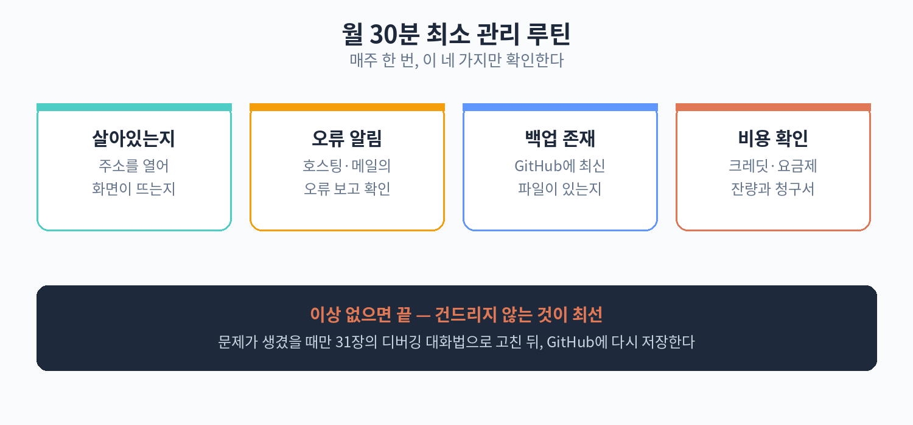

# 50. 만든 뒤의 최소 관리 루틴과 비용

서비스를 만드는 것보다 어려운 것이 만든 것을 계속 돌리는 것이다. 다행히 비개발자가 운영하는 작은 서비스라면, 월 30분에서 1시간의
관리만으로도 충분히 유지할 수 있다. 이 장에서는 최소 관리 루틴, 비용 구조, 비용 폭탄을 피하는 습관을 차례대로 정리한다.

## 월 30분 최소 관리 루틴

서비스가 돌아가고 있는 한, 주 1회 10분씩만 확인하면 된다. 확인 항목은 세 가지이다.

첫째, 서비스가 살아 있는지 확인한다. 브라우저에 주소를 입력해 화면이 뜨는지 본다. 화면이 안 뜨면 호스팅 서비스의 상태 페이지나 알림을
확인한다. 대부분은 일시적인 문제이지만, 며칠째 안 뜨면 조치가 필요하다. 북마크바에 서비스 주소를 넣어 두고, 주 1회 클릭하는 습관이 가장
간단하다.

둘째, 오류 알림을 확인한다. 요즘 호스팅 서비스는 오류가 생기면 이메일이나 메시지로 알려 주는 기능을 제공한다. 알림이 와 있는지 확인하고,
알림이 오면 내용을 읽어 본다. 이해가 안 되는 알림이면 AI에게 "이 오류 메시지가 무슨 뜻인지 설명해 줘"라고 물어보면 된다. 당장 고치지
못해도, 문제를 알고 있는 것과 모르는 것은 다르다.

셋째, 백업이 존재하는지 확인한다. 백업(Backup)은 데이터를 복사해 따로 보관하는 것이다. 서비스에 저장된 데이터(주문 내역, 예약 목록,
고객 문의 같은)가 있다면, 백업이 자동으로 되고 있는지 확인한다. 백업이 있다는 것만 확인하면 된다. 실제로 복원해 볼 필요는 없다. 백업
설정은 서비스를 만들 때 한 번 해 두면 자동으로 돌아가는 경우가 많다.

이 세 가지를 주 1회, 한 번에 10분이면 된다. 한 달이면 40분 정도이다. 달력에 "서비스 점검"이라는 반복 일정을 넣어 두면 잊지
않는다.

## 비용 구조 이해하기

바이브 코딩으로 만든 서비스의 비용은 크게 세 가지이다. 호스팅 비용, AI 도구 구독료, 도메인 비용이다.

### 호스팅 비용: 무료로 시작하고, 커지면 유료로

호스팅(Hosting)은 만든 서비스를 인터넷에 올려 두는 것이다. 집을 지으면 땅이 필요하듯, 서비스에는 서버라는 땅이 필요하다. 다행히 작은
서비스는 무료로 올릴 수 있는 곳이 많다. Vercel, Netlify, Cloudflare Pages 같은 서비스가 대표적이다. 방문자가 적고
데이터가 적으면 무료 한도 안에서 충분히 돌아간다.

유료로 전환해야 하는 시점은 정해져 있다. 방문자가 무료 한도를 넘었을 때, 데이터 저장 용량이 찼을 때, 더 빠른 속도가 필요할 때이다. 유료
요금은 보통 월 5천 원에서 2만 원대부터 시작한다. 갑자기 큰돈이 나가는 구조가 아니라, 쓰면 쓸수록 조금씩 늘어나는 구조이다.

### AI 도구 구독료

바이브 코딩에 쓰는 AI 도구는 대부분 월 구독제이다. 코드 생성 AI, 대화형 AI의 유료 요금제 같은 것이다. 월 2만 원에서 3만 원대인
경우가 많다. 무료로도 쓸 수 있는 도구가 있지만, 작업량이 많아지면 유료 요금제가 편해진다.

중요한 것은 "만드는 동안"과 "운영하는 동안"의 비용이 다르다는 점이다. 서비스를 만드는 동안에는 AI를 많이 쓰니 구독료가 들지만, 만들고
나서는 AI를 쓸 일이 줄어든다. 운영 단계에서는 구독을 낮추거나 잠시 쉬는 것도 방법이다. 고칠 일이 생겼을 때만 다시 구독하면 된다.

### 도메인 비용

도메인(Domain)은 서비스의 주소이다. 예를 들어 "mystore.kr" 같은 것이다. 도메인은 연 단위로 비용이 들고, 보통 연 1만
원에서 2만 원대이다. 꼭 필요한 것은 아니지만(호스팅 서비스가 주는 무료 주소도 있다), 사업용이라면 있는 것이 신뢰도가 높다.

### 월 예산표 예시

작은 서비스를 운영하는 경우의 월 예산 예시이다. 실제 금액은 서비스마다 다르니 참고용으로 보자.

| 항목 | 무료 단계 | 유료 단계 |
|---|---|---|
| 호스팅 | 0원 (무료 한도 내) | 월 5,000~20,000원 |
| AI 도구 구독 | 0원 (무료 요금제) | 월 20,000~30,000원 (작업할 때만) |
| 도메인 | 0원 (무료 주소 사용) | 월 약 1,500원 (연 1~2만 원) |
| 합계 | 0원 | 월 약 27,000~52,000원 |

보다시피, 작은 규모에서는 무료로 운영할 수 있고, 유료로 전환해도 월 5만 원 안팎이다. "일단 무료로 시작하고, 잘 되면 유료로"가 기본
전략이다.

## 비용 폭탄을 피하는 습관

클라우드 서비스에서 가장 무서운 것은 예상 못한 요금이다. "무료인 줄 알았는데 몇십만 원이 청구됐다"는 이야기가 심심찮게 들린다. 대부분은
한도를 모르고 썼거나, 알림 설정을 안 해 둬서 생긴다. 세 가지 습관으로 예방할 수 있다.

첫째, 크레딧과 토큰 잔량을 주기적으로 확인한다. AI 도구에는 사용량 한도(크레딧, 토큰 같은)가 있다. 한도를 넘으면 추가 요금이 붙거나
서비스가 멈춘다. 월 1회, 구독 관리 화면에 들어가 잔량을 확인한다. 점검 루틴에 "잔량 확인"을 추가해 두면 잊지 않는다.

둘째, 사용량 알림을 설정한다. 대부분의 유료 서비스는 "사용량이 이만큼 되면 알려 줘"라는 알림을 설정할 수 있다. 예를 들어 무료 한도의
80%에 도달하면 이메일로 알려 달라고 설정한다. 알림이 오면 그때 유료 전환을 고민하면 된다. 청구서를 보고 놀라는 일은 없어진다.

셋째, 자동 결제에 등록된 카드를 확인한다. 무료 체험으로 시작했다가 유료로 자동 전환되는 서비스가 있다. "무료 체험 30일" 같은 것은
달력에 종료일을 적어 두고, 계속 쓸지 말지 미리 정한다. 쓰지 않을 서비스의 자동 결제는 바로 해지한다. 월 1회 카드 명세서를 보며 "이
결제가 뭐였지"를 확인하는 습관이 돈을 지킨다.

## 실습: 월 유지비 체크리스트

아래 표를 복사해 자신의 서비스에 맞게 채워 보자. 한 달에 한 번, 점검 루틴과 함께 보면 된다.

| 확인 항목 | 주기 | 상태 | 비고 |
|---|---|---|---|
| 서비스 화면이 정상적으로 뜨는가 | 주 1회 | 예 / 아니오 | 주소 북마크해 두기 |
| 오류 알림이 와 있지 않은가 | 주 1회 | 예 / 아니오 | 알림 수신 주소 확인 |
| 백업이 정상적으로 되고 있는가 | 주 1회 | 예 / 아니오 | 자동 백업 설정 확인 |
| 호스팅 사용량이 무료 한도 내인가 | 월 1회 | 예 / 아니오 | 80% 도달 시 알림 설정 |
| AI 도구 크레딧/토큰 잔량 | 월 1회 | 충분 / 부족 | 부족하면 요금제 검토 |
| 자동 결제 중인 서비스 목록 | 월 1회 | 확인 완료 | 안 쓰는 것은 해지 |
| 도메인 만료일 | 연 1회 | 날짜 기입 | 만료 30일 전 알림 설정 |

'상태' 칸에 매번 표시하다 보면, 문제가 생기기 전에 미리 알 수 있다. 체크리스트는 인쇄해서 책상 앞에 붙여 두거나, 휴대폰 메모에 저장해
두면 된다.

## 문제가 생겼을 때의 순서

점검 중에 문제를 발견하면 당황하지 말고 아래 순서대로 한다.

1. 문제를 기록한다. "언제부터", "무엇이", "어떻게" 안 되는지를 적는다. 화면 캡처도 좋다.
2. AI에게 물어본다. 오류 메시지를 그대로 복사해 "이 오류가 무슨 뜻이고 어떻게 고치면 돼?"라고 묻는다.
3. AI의 답대로 고쳐 보고, 안 되면 호스팅 서비스의 도움말이나 고객센터를 찾는다.
4. 그래도 안 되면 전문가에게 의뢰한다. 기록해 둔 1번 자료가 있으면 의뢰가 빠르고 정확해진다.

대부분의 문제는 2번에서 해결된다. 4번까지 가는 경우는 드물지만, 그때를 위해 기록을 남기는 습관이 중요하다.

## 1년에 한 번 할 일

월간 루틴 외에, 1년에 한 번은 조금 더 깊이 점검한다. 연말이나 한가한
시기에 반나절을 잡으면 된다.

첫째, 도메인 만료일을 확인한다. 도메인은 연 단위 비용이라 잊기 쉽다.
만료되면 서비스 주소가 사라진다. 만료 30일 전에 알림이 오도록 설정해
두었는지 확인한다.

둘째, 쓰지 않는 유료 서비스를 정리한다. 1년 동안 한 번도 안 쓴 AI 구독이나
호스팅 요금제가 있는지 본다. "나중에 쓸지도 몰라"라는 생각으로 유지하는
구독이 의외로 많다.

셋째, AI에게 전체 점검을 부탁한다. "이 서비스의 코드를 전체적으로 보고,
보안상 위험하거나 고칠 곳이 있으면 알려 줘"라고 말한다. 12장의 유지보수
부채 예방과 같은 맥락이다. 1년에 한 번의 대청소인 셈이다.

넷째, 백업을 실제로 내려받아 본다. 백업이 "있다"는 것과 백업 파일이
"열린다"는 것은 다르다. 1년에 한 번은 백업 파일을 내려받아 열리는지
확인한다. 열리지 않는 백업은 없는 것과 같다.

## 서비스를 접을 때의 정리 순서

서비스를 접게 되는 날도 온다. 접을 때도 순서가 있다. 대충 끄면 데이터가
남거나 요금이 계속 나갈 수 있다.

1. 데이터를 내려받는다. 주문 내역, 고객 목록, 문의 기록처럼 나중에
필요할 수 있는 데이터를 파일로 저장한다.
2. 사용자에게 알린다. 쓰는 사람이 있다면 "언제 종료된다"고 미리 공지한다.
갑자기 꺼지면 신뢰를 잃는다.
3. 자동 결제를 해지한다. 호스팅, 도메인, AI 구독의 자동 결제를 끈다.
이것을 빼먹으면 안 쓰는 서비스에 요금이 계속 나간다.
4. 서비스를 내린다. 호스팅에서 배포를 중단하거나 삭제한다.
5. 도메인은 바로 버리지 않는다. 만료까지 두면, 주소를 기억하고 찾아오는
사람에게 "종료됐다"는 안내를 보여 줄 수 있다. 다음 갱신 시점에 버리면 된다.

접는 것도 관리의 일부이다. 깔끔하게 접은 경험은 다음 서비스를 만들 때
자산이 된다.

## 정리

만든 서비스는 월 30분에서 1시간의 관리로 유지할 수 있다. 주 1회 서비스 생존 확인, 오류 알림 확인, 백업 존재 확인이 핵심이다. 비용은
무료로 시작해 필요할 때 유료로 전환하는 구조이고, 작은 서비스는 월 5만 원 안팎이면 충분하다. 비용 폭탄을 피하려면 잔량 확인, 사용량
알림, 자동 결제 점검의 습관을 들이자. 이 책의 Part 1에서 Part 5까지, 바이브 코딩의 개념부터 만들기, 운영까지의 흐름을 모두
다뤘다. 이제 직접 만들어 볼 차례이다.

---

이 책에 대한 문의는 이메일 1130dlwltn2@gmail.com 또는 AI 정보공유 단톡방
https://open.kakao.com/o/s4OEqBai 로 연락할 수 있다. 예제 코드와 추가 자료는 GitHub 저장소
https://github.com/1130dlwltn2-sondol/vibe-coding-practice 에서 받을 수 있다.
